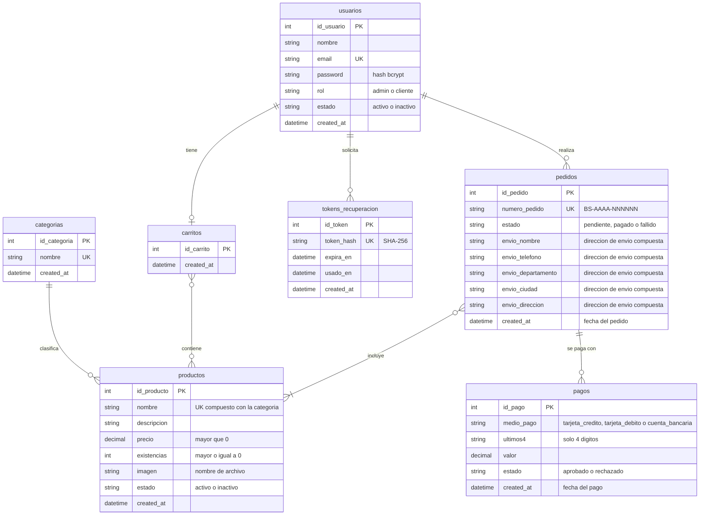

# Modelo de datos · Bike Store

Diseñado y aprobado en el chat de modelado (fases A–D). PostgreSQL 15+. La implementación física está en `database/migrations/002_modelo_bike_store.sql`.

## Decisiones de diseño

1. **3FN.** Las copias históricas (`detalle_pedido.precio_unitario` y `pedidos.envio_*`) son una foto del momento de la compra, no redundancia.
2. **Convenciones:**
   - Tablas en snake_case y en plural.
   - PK `id_<singular>` de tipo `INT GENERATED ALWAYS AS IDENTITY`.
   - `created_at TIMESTAMPTZ` en todas las tablas.
   - Imágenes en disco: en la base solo va el nombre del archivo.
3. **ENUM nativos:** `rol_usuario`, `estado_registro` (lo comparten usuarios y productos), `estado_pedido`, `medio_pago_tipo` y `estado_pago`. Los roles son un ENUM, no una tabla, porque hay dos roles fijos y un solo rol por usuario.
4. **Unicidad sin distinguir mayúsculas** con índices sobre `lower(...)`: `usuarios.email`, `categorias.nombre` y `(id_categoria, lower(nombre))` en `productos`.
5. **Productos:**
   - `descripcion` es opcional.
   - `imagen` es obligatoria.
   - `precio > 0` y `existencias >= 0`.
   - Borrado lógico mediante `estado`.
6. **Carrito:** uno por cliente (`carritos.id_usuario UNIQUE`); `carrito_items` con `UNIQUE(id_carrito, id_producto)`. Se vacía al pagar.
7. **Número de pedido:** `BS-AAAA-NNNNNN`, asignado por el trigger `trg_pedidos_numero`.
8. **Total:** no se almacena. Se calcula con `SUM(cantidad * precio_unitario)`, y `pagos.valor` guarda lo efectivamente pagado.
9. **Pagos:** solo `medio_pago`, `ultimos4`, `valor`, `estado` y fecha. Un índice único parcial permite un solo pago `aprobado` por pedido.
10. **Flujo de pago y stock:** el pedido nace `pendiente` sin tocar el stock. Al pagar, todo ocurre en una transacción:
    1. bloquear los productos;
    2. validar estado y existencias;
    3. simular el pago;
    4. si se aprueba: descontar stock, registrar el pago, pasar el pedido a `pagado` y vaciar el carrito;
    5. si se rechaza: registrar el pago `rechazado` y pasar el pedido a `fallido`.
11. **Llaves foráneas:** `ON UPDATE CASCADE` en todas. `ON DELETE CASCADE` solo en carritos→usuarios, carrito_items→carritos y tokens→usuarios; las demás son `RESTRICT`.
12. **Índices:**
    - catálogo: `(estado, id_categoria, precio)` y `(estado, precio)`;
    - tablero: `pedidos (estado, created_at)` y `detalle_pedido (id_producto)`;
    - además, un índice en cada FK.
13. **Dirección de envío:** atributo compuesto copiado en el pedido (no hay libreta de direcciones).
14. **Recuperación de contraseña:** `tokens_recuperacion` guarda el SHA-256 del token, `expira_en` y `usado_en`.
15. **Alertas del tablero:** se calculan por consulta, sin tablas propias.

## MER (Mermaid)

## Tablas (resumen del modelo relacional)

| Tabla | Columnas principales | Claves |
|-------|----------------------|--------|
| `usuarios` | nombre, email, password, rol, estado | PK `id_usuario`; único `lower(email)` |
| `categorias` | nombre | PK `id_categoria`; único `lower(nombre)` |
| `productos` | id_categoria, nombre, descripcion, precio, existencias, imagen, estado | FK → categorias; único `(id_categoria, lower(nombre))` |
| `carritos` | id_usuario | FK → usuarios (único) |
| `carrito_items` | id_carrito, id_producto, cantidad | FK → carritos, productos; único `(id_carrito, id_producto)` |
| `pedidos` | numero_pedido, id_usuario, estado, envio_* | FK → usuarios; único `numero_pedido` |
| `detalle_pedido` | id_pedido, id_producto, cantidad, precio_unitario | FK → pedidos, productos; único `(id_pedido, id_producto)` |
| `pagos` | id_pedido, medio_pago, ultimos4, valor, estado | FK → pedidos; único parcial `(id_pedido) WHERE estado='aprobado'` |
| `tokens_recuperacion` | id_usuario, token_hash, expira_en, usado_en | FK → usuarios; único `token_hash` |

El DDL completo, con tipos, CHECK, índices y trigger, es la fuente de verdad: `database/migrations/002_modelo_bike_store.sql`.
