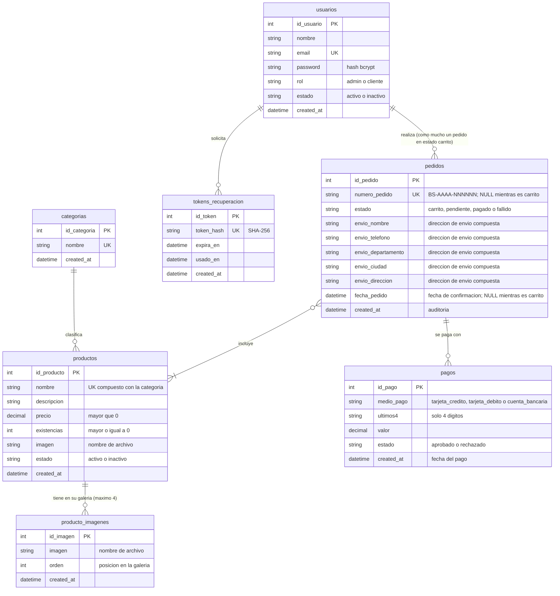

# Modelo de datos · Bike Store

> **Para qué sirve:** resume el modelo de datos aprobado: decisiones, MER y tablas.
> **Cuándo usarlo:** cuando necesites saber qué tabla o columna guarda un dato. El porqué de cada decisión está en [JUSTIFICACION_MODELO_DATOS](JUSTIFICACION_MODELO_DATOS.md).
> ← Volver al [índice de la documentación](../README.md) · Términos desconocidos: [GLOSARIO](../GLOSARIO.md)

Diseñado y aprobado en el chat de modelado (fases A–D). [PostgreSQL](../GLOSARIO.md#postgresql) 15+. La implementación física está en [`database/migrations/002_modelo_bike_store.sql`](../../database/migrations/002_modelo_bike_store.sql), con el cambio de la decisión 6 aplicado por las migraciones `004_estado_pedido_carrito.sql` y `005_carrito_como_pedido.sql` (decisión D12 del [ROADMAP](../ROADMAP.md#resueltas)) y la galería de imágenes de la `006_producto_imagenes.sql` (decisión M).

## Decisiones de diseño

1. **3FN.** Las copias históricas (`detalle_pedido.precio_unitario` y `pedidos.envio_*`) son una foto del momento de la compra, no redundancia.
2. **Convenciones:**
   - Tablas en snake_case y en plural.
   - PK `id_<singular>` de tipo `INT GENERATED ALWAYS AS IDENTITY`.
   - `created_at TIMESTAMPTZ` en todas las tablas.
   - Imágenes en disco: en la base solo va el nombre del archivo.
3. **ENUM nativos:** `rol_usuario`, `estado_registro` (lo comparten usuarios y productos), `estado_pedido`, `medio_pago_tipo` y `estado_pago`. Los roles son un ENUM, no una tabla, porque hay dos roles fijos y un solo rol por usuario.
4. **Unicidad sin distinguir mayúsculas** con índices sobre `lower(...)`: `usuarios.email`, `categorias.nombre` y `(id_categoria, lower(nombre))` en `productos`.
5. **Productos:**
   - `descripcion` es opcional.
   - `imagen` es obligatoria.
   - `precio > 0` y `existencias >= 0`.
   - Borrado lógico mediante `estado`.
6. **Carrito = pedido en borrador** (D12). No hay tablas de carrito: el carrito es el pedido del cliente con `estado = 'carrito'`, y sus líneas son filas de `detalle_pedido`.
   - Uno por cliente: índice único parcial `uq_pedidos_carrito_usuario ON pedidos (id_usuario) WHERE estado = 'carrito'` (R2).
   - Un producto no se repite: `UNIQUE (id_pedido, id_producto)` de `detalle_pedido`; si se agrega de nuevo, se suman cantidades.
   - Mientras es carrito no tiene `numero_pedido`, `fecha_pedido` ni datos de envío (columnas que admiten NULL). El CHECK `ck_pedidos_confirmado` los exige en cualquier otro estado.
   - Vaciar o quitar líneas borra filas de `detalle_pedido`, nunca el pedido.
   - Antes existían `carritos` y `carrito_items`; la migración 005 convirtió sus datos y las eliminó.
7. **Número y fecha del pedido:** el trigger `trg_pedidos_numero` (`BEFORE INSERT OR UPDATE OF estado`) actúa cuando el pedido sale del estado `carrito`: asigna `fecha_pedido` (momento de confirmación) y `numero_pedido` con el formato `BS-AAAA-NNNNNN`. `created_at` queda como auditoría (en un carrito, cuándo se empezó).
8. **Total:** no se almacena. Se calcula con `SUM(cantidad * precio_unitario)`, y `pagos.valor` guarda lo efectivamente pagado.
9. **Pagos:** solo `medio_pago`, `ultimos4`, `valor`, `estado` y fecha. Un índice único parcial permite un solo pago `aprobado` por pedido.
10. **Flujo de compra, pago y stock:**
    - **Confirmar** (carrito → `pendiente`): valida productos activos y existencias, refresca `precio_unitario` al precio vigente (R3), guarda `envio_*` y cambia el estado en un solo `UPDATE`. No toca el stock. El carrito queda vacío porque ya es el pedido.
    - **Pagar**, todo en una transacción:
      1. bloquear el pedido y los productos (orden por `id_producto`);
      2. validar estado y existencias;
      3. simular el pago;
      4. si se aprueba: descontar stock, registrar el pago y pasar el pedido a `pagado`;
      5. si se rechaza: registrar el pago `rechazado` y pasar el pedido a `fallido`.
11. **Llaves foráneas:** `ON UPDATE CASCADE` en todas. `ON DELETE CASCADE` solo en tokens→usuarios y en producto_imagenes→productos (decisión M); las demás son `RESTRICT` (incluida `detalle_pedido`→`pedidos`). Por eso una categoría con productos, o un producto que está en algún carrito o pedido, no se puede eliminar.
12. **Índices:**
    - catálogo: `(estado, id_categoria, precio)` y `(estado, precio)`;
    - tablero: `pedidos (estado, fecha_pedido)` y `detalle_pedido (id_producto)`;
    - carrito: único parcial `pedidos (id_usuario) WHERE estado = 'carrito'`;
    - además, un índice en cada FK.
13. **Dirección de envío:** atributo compuesto copiado en el pedido (no hay libreta de direcciones).
14. **Recuperación de contraseña:** `tokens_recuperacion` guarda el SHA-256 del token, `expira_en` y `usado_en`.
15. **Alertas del tablero:** se calculan por consulta, sin tablas propias. Las métricas cuentan solo pedidos `pagado` filtrados por `fecha_pedido`; "productos inactivos en carritos" consulta `detalle_pedido` unido a `pedidos` con `estado = 'carrito'`.

## MER (Mermaid)

## Tablas (resumen del modelo relacional)

| Tabla | Columnas principales | Claves |
|-------|----------------------|--------|
| `usuarios` | nombre, email, password, rol, estado | PK `id_usuario`; único `lower(email)` |
| `categorias` | nombre | PK `id_categoria`; único `lower(nombre)` |
| `productos` | id_categoria, nombre, descripcion, precio, existencias, imagen, estado | FK → categorias; único `(id_categoria, lower(nombre))`. `imagen` es la portada |
| `producto_imagenes` | id_producto, imagen, orden | FK → productos (`ON DELETE CASCADE`); índice `(id_producto, orden)`. Imágenes adicionales (máximo 4; el límite lo aplica el backend) |
| `pedidos` | numero_pedido, id_usuario, estado, envio_*, fecha_pedido | FK → usuarios; único `numero_pedido`; único parcial `(id_usuario) WHERE estado='carrito'`; CHECK `ck_pedidos_confirmado` |
| `detalle_pedido` | id_pedido, id_producto, cantidad, precio_unitario | FK → pedidos, productos; único `(id_pedido, id_producto)`. Guarda las líneas del carrito y las del pedido |
| `pagos` | id_pedido, medio_pago, ultimos4, valor, estado | FK → pedidos; único parcial `(id_pedido) WHERE estado='aprobado'` |
| `tokens_recuperacion` | id_usuario, token_hash, expira_en, usado_en | FK → usuarios; único `token_hash` |

El DDL completo, con tipos, CHECK, índices y trigger, es la fuente de verdad: `database/migrations/002_modelo_bike_store.sql` más las migraciones posteriores (`004`, `005` y `006`), que se aplican en orden.
